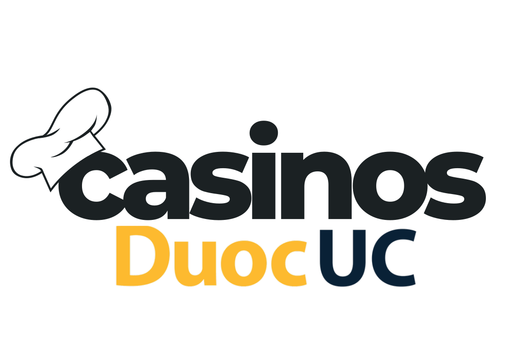

<p align="center">
  <picture>
    <source media="(prefers-color-scheme: dark)" srcset="https://raw.githubusercontent.com/iscovarrubias/APT122-Casino-DUOC/main/FASE%202/Evidencias%20Proyecto/Evidencias%20de%20sistema/Aplicacion/frontend/public/logooscuro.svg">
    <source media="(prefers-color-scheme: light)" srcset="https://raw.githubusercontent.com/iscovarrubias/APT122-Casino-DUOC/main/FASE%202/Evidencias%20Proyecto/Evidencias%20de%20sistema/Aplicacion/frontend/public/logo.svg">
    
  </picture>
</p>

# Proyecto APT122: Plataforma de gestión y análisis de la oferta gastronómica del Casino DUOC UC

Plataforma web para el casino de la sede Valparaíso de DUOC UC, los estudiantes consultan el menú del día desde el celular o el computador antes de ir al casino, y el personal planifica el menú, controla la jornada de almuerzos y analiza la demanda con datos.

**Aplicación publicada:** [casino-duoc-web.onrender.com](https://casino-duoc-web.onrender.com/)

## Equipo

| Integrante | Usuario GitHub | Rol | Funciones principales |
|---|---|---|---|
| **Isabella Covarrubias** | [@iscovarrubias](https://github.com/iscovarrubias) | Líder técnica y desarrolladora full-stack | Definió la arquitectura (Express + PostgreSQL + React) y el modelo de datos. Desarrolló la mayor parte del backend y el frontend: autenticación JWT y Microsoft Entra ID, control de acceso por rol, módulo de jornada y stock, predicción de demanda y tiempo real con SSE. Diseñó la identidad visual (tema claro/oscuro, componentes reutilizables). Coordinó el alcance del MVP y la priorización del backlog. |
| **Diego Díaz** | [@diediazp](https://github.com/diediazp) | Analista de calidad, infraestructura y documentación | Revisó que lo implementado cumpliera los requisitos y el alcance definido. Desarrolló el diseño responsive (móvil, tablet y escritorio), los diagramas UML y los esquemas de base de datos, y apoyó el backend en el acceso con Microsoft Entra ID y en los últimos sprints. Mantuvo la documentación técnica y académica, y gestionó los entregables de cada fase en el repositorio. |

## Componente de innovación

La idea inicial era que los estudiantes pudieran consultar el menú desde el celular. Eso por sí solo es un CRUD de menú, como observó la docente. La innovación del proyecto está en **pasar de publicar el menú a gestionar la oferta del casino con datos**:

| Innovación | Qué resuelve | Cómo funciona |
|---|---|---|
| **Predicción de demanda por categoría** | El casino prepara a ojo: algunos días sobra comida y otros se agota temprano. | Sugiere cuántas porciones preparar con un rango mínimo-máximo. Usa los últimos mismos días de la semana y corrige al alza los días en que el plato se agotó, porque lo vendido ese día fue menos que la demanda real. |
| **Validación de la predicción (backtesting)** | Una predicción sin medir no sirve para decidir. | El sistema prueba la predicción contra días pasados y muestra su error promedio comparado con un promedio simple, para saber si realmente aporta. |
| **Hora estimada de agotamiento** | El estudiante llega y el plato ya no está. | Con el ritmo de venta del día y la curva histórica, estima a qué hora se agotará cada plato. |
| **Disponibilidad real en tiempo real** | La planificación mensual no refleja lo que pasa durante el día (confirmado en la entrevista con la encargada del casino). | Cada venta en caja descuenta el stock exacto, y el menú público se actualiza al instante (SSE) mostrando lo que queda y lo agotado. |
| **Personalización por alergias** | Los estudiantes confían poco en la información de alérgenos (2,23/5 en la encuesta, n=31). | El estudiante marca sus alergias y el menú le avisa en los platos que las contienen. La información nutricional se calcula desde los ingredientes y nunca se inventa: si falta un dato, se muestra "No disponible". |
| **Diseño preparado para el concesionario** | El casino lo opera Campomar Ltda., no DUOC, así que no hay acceso garantizado a sus datos de caja. | El modelo distingue el origen de cada venta (real, importada o simulada) y funciona en los tres escenarios (A, B o C) sin rediseñarse. |

**Alcance de la innovación:** la predicción es estadística (promedio ponderado con corrección por agotamientos), no aprendizaje automático. Además, hoy se valida con datos de venta simulados (escenario C). Con datos reales de Campomar (escenarios A o B) solo cambia la fuente de datos.

## Hallazgo clave del levantamiento

El casino no lo administra DUOC directamente, sino un concesionario externo, **Campomar Ltda.**, lo que confirmamos con información pública de la empresa y con el jefe de carrera. Por eso la integración con el sistema de caja del concesionario se trata como una funcionalidad condicionada a la factibilidad técnica y a una autorización institucional, y no como un requisito del MVP. El proyecto contempla tres escenarios:

| Escenario | Qué requiere | Estado |
|---|---|---|
| A, integración real | Un acuerdo entre DUOC y Campomar para conectarse a su caja | Pendiente |
| B, importación de datos | Que Campomar acceda a exportar sus ventas | Pendiente |
| C, datos simulados | Nada externo, es el camino base | En uso |

Las ventas simuladas quedan marcadas como `simulado` en la base de datos y la predicción avisa cuando trabaja con ellas. Si se concreta el escenario A o B, cambia la fuente de los datos y el modelo se mantiene igual.

## Levantamiento de información (Fase 1)

- **Entrevista con la encargada del casino:** confirmó que la planificación del menú puede cambiar durante el día por razones operativas, por eso el sistema separa lo planificado de lo que realmente está disponible.
- **Encuesta a 31 estudiantes:** el 87 % usaría una plataforma web para revisar el menú, y la confianza en la información actual de alérgenos e ingredientes fue de 2,23 sobre 5.
- **Afiche de planificación mensual de Campomar:** muestra que la información del menú ya existe, pero llega a docentes y administrativos y no a los estudiantes. El menú cargado en la demostración se basa en este afiche.
- **Respuesta de la nutricionista:** confirmó que los alérgenos se declaran por preparación y que hoy no existe información nutricional completa documentada para cada plato.

## Qué hace la plataforma

**Estudiantes.** Consultan el menú del día por categoría (General, JUNAEB, Vegetariano e Hipocalórico) con precio, calorías, ingredientes, tabla nutricional y alérgenos, sin necesidad de cuenta. Ven en tiempo real cuántas porciones quedan, y el menú les avisa en qué momento está la jornada: antes de iniciarse muestra "Aún no inicia la jornada", después del cierre indica que la jornada de almuerzos terminó, y los fines de semana los invita a revisar el menú de la semana siguiente. Con su cuenta institucional pueden registrar alergias, elegir su categoría favorita, marcar platos favoritos y dejar calificaciones con comentario.

**Personal del casino.** Según su rol (Administrador, Personal Casino, Cajero o Nutricionista), planifica el menú por día o por mes con sugerencias de cantidad, revisa la receta de cada plato y crea variaciones cuando un día se prepara distinto, gestiona ingredientes y preparaciones con cálculo nutricional automático, vende combos en caja con un toque, controla el stock durante la jornada, cierra con conteo de sobrantes y analiza ventas, agotamientos, predicción y opiniones.

## Estado del proyecto

**Fase 1, definición del proyecto APT:** cerrada. Incluyó el levantamiento, la especificación de requerimientos, el documento de alcance y el backlog de historias de usuario.

**Fase 2, diseño y desarrollo:** el sistema está publicado y funcionando de punta a punta. Cada sprint se refleja en una migración de la base de datos:

| Sprint | Contenido |
|---|---|
| 1 | Login con JWT, roles y gestión de preparaciones |
| 2 | Planificación del menú, alérgenos e información nutricional |
| 3 | Disponibilidad del día, historial de menús, análisis básico y zona horaria de Chile |
| 4 | Tipo de componente y subida de imágenes |
| 5 | Ingredientes con composición por 100 g y cálculo nutricional desde la receta |
| 6 | Jornada (inicio, venta y cierre), stock exacto por movimientos, roles Cajero y Nutricionista, tiempo real con SSE |
| 7 | Vista mensual, copia de menús entre fechas y precio por categoría |
| 8 | Perfil del estudiante (alergias, favoritos y calificaciones) y predicción de demanda con backtesting |
| 9 | Categoría preferida del estudiante |
| 10 y 11 | Historial de opiniones que conserva las editadas y eliminadas, con el correo del autor |
| 12 | Inicio de sesión con Microsoft Entra ID y tickets de acceso de un solo uso |
| 13 | Índices de rendimiento en la planificación |
| 14 | Tema claro u oscuro guardado por usuario |
| 15 | Imágenes de las preparaciones guardadas en la base de datos |
| 16 y 17 | Composición del combo por categoría (ensalada, sopa, pan, postre o fruta y bebida) |
| 18 | La categoría "Principal" pasa a llamarse "General" |
| 19 y 20 | Tipos de venta (combo, solo plato y completo con bebida de máquina) y corrección del cierre de jornada |
| 21 | Variaciones de receta en la planificación |
| 22 | Hora estimada de agotamiento para los estudiantes, avisos por correo del menú semanal y de los favoritos, y páginas de Términos y Privacidad |

## Tecnologías

| Capa | Herramientas |
|---|---|
| Frontend | React 19 y Vite 8, aplicación de página única responsive con tema claro y oscuro |
| Backend | Node.js 20+ y Express 5, API REST con eventos en tiempo real (SSE) |
| Base de datos | PostgreSQL 14+, elegido por el historial de menús y las relaciones muchos a muchos entre preparaciones e ingredientes |
| Autenticación | JWT, contraseña para el personal y Microsoft Entra ID (OIDC con PKCE) para los estudiantes |
| Calidad | Más de 700 pruebas con `node:test`, Vitest y Playwright (unitarias, integración, seguridad, robustez, carga de hora punta, contrato entre frontend y backend, de punta a punta en navegador para cada funcionalidad y rol, y accesibilidad WCAG 2.1 AA con axe), 89 % de cobertura en el backend y 93 % en el frontend, oxlint, Prettier, Dependabot, CodeQL e integración continua con GitHub Actions |
| Despliegue | Render (frontend y backend) y Neon (PostgreSQL), también se puede levantar con Docker Compose |

## Metodología

Trabajamos con un enfoque ágil, usamos técnicas de Design Thinking para validar los requerimientos en la Fase 1 y sprints Scrum de dos semanas desde el diseño del modelo de datos en la Fase 2. Descartamos las metodologías tradicional y RUP porque ambas exigen requerimientos cerrados antes de diseñar, y al comienzo el proyecto todavía no los tenía, sobre todo por la incertidumbre sobre el acceso a los datos del concesionario.

## Arquitectura

La aplicación está organizada en capas:

- **Presentación:** aplicación React que consume la API REST y se conecta por SSE para recibir los cambios de stock y disponibilidad al instante.
- **Lógica de negocio:** backend Express organizado en rutas, controladores (validación de la entrada y respuesta HTTP) y modelos (acceso a datos y transacciones).
- **Persistencia:** PostgreSQL con un modelo relacional que separa la planificación del menú de lo que realmente ocurre durante la jornada, y que guarda el historial de stock y de opiniones sin borrarlo.
- **Seguridad:** JWT con control de acceso por rol en cada ruta del personal.

El detalle de las capas, las decisiones de diseño y los diagramas están en el [documento de arquitectura](./FASE%202/Evidencias%20Proyecto/Evidencias%20de%20documentaci%C3%B3n/01_Documento_Arquitectura_Casino_DUOC.docx).

## Estructura del repositorio

```text
APT122-Casino-DUOC/
├── FASE 1/
│   ├── Evidencias Grupales/          Presentación, formativa y definición del proyecto
│   ├── Evidencias Individuales/      Autoevaluaciones y diarios de reflexión
│   └── Evidencias Proyecto/
│       └── Evidencias de documentacion/
│           └── Levantamiento/        Entrevista, afiche, encuesta y respuesta de la nutricionista
├── FASE 2/
│   ├── Evidencias Grupales/          Formativa de avance y guías
│   ├── Evidencias Individuales/      Diarios de reflexión y autoevaluaciones
│   └── Evidencias Proyecto/
│       ├── Evidencias de documentación/   Arquitectura, modelo ER, plan de pruebas, UML y backlog
│       └── Evidencias de sistema/
│           ├── Aplicacion/           Código del sistema (backend, frontend y documentación técnica)
│           └── Base de datos/        Modelo inicial y esquema de la base de datos
└── README.md
```

La instalación, las pruebas y el despliegue se explican en el README de la aplicación, y cada parte tiene el suyo:

- [Aplicación](./FASE%202/Evidencias%20Proyecto/Evidencias%20de%20sistema/Aplicacion/README.md)
- [Backend](./FASE%202/Evidencias%20Proyecto/Evidencias%20de%20sistema/Aplicacion/backend/README.md)
- [Frontend](./FASE%202/Evidencias%20Proyecto/Evidencias%20de%20sistema/Aplicacion/frontend/README.md)

## Documentación

| Documento | Contenido |
|---|---|
| [Entrevista con la encargada del casino](./FASE%201/Evidencias%20Proyecto/Evidencias%20de%20documentacion/Levantamiento/01_Entrevista_Encargada_Casino.md) | Hallazgos sobre la planificación del menú y cómo se ejecuta en la práctica |
| [Afiche de Campomar](./FASE%201/Evidencias%20Proyecto/Evidencias%20de%20documentacion/Levantamiento/02_Comunicacion_Menu_Actual.png) | Cómo se comunica hoy el menú y por qué no llega a los estudiantes |
| [Resultados de la encuesta](./FASE%201/Evidencias%20Proyecto/Evidencias%20de%20documentacion/Levantamiento/03_Resultados_Encuesta.pdf) | Resumen de resultados, n=31 |
| [Instrumento de la encuesta](./FASE%201/Evidencias%20Proyecto/Evidencias%20de%20documentacion/Levantamiento/04_Encuesta_Estudiantes.pdf) | Formulario aplicado a los estudiantes |
| [Respuesta de la nutricionista](./FASE%201/Evidencias%20Proyecto/Evidencias%20de%20documentacion/Levantamiento/05_Respuesta_Nutricionista.pdf) | Alérgenos e información nutricional disponible |
| [Documento de alcance](./FASE%202/Evidencias%20Proyecto/Evidencias%20de%20documentaci%C3%B3n/08_Documento_Alcance_APT122_Casino_DUOC.docx) | Alcance del MVP, escenarios y exclusiones |
| [Especificación de requerimientos](./FASE%202/Evidencias%20Proyecto/Evidencias%20de%20documentaci%C3%B3n/07_Especificacion_Requerimientos.docx) | Requerimientos funcionales |
| [Requisitos no funcionales](./FASE%202/Evidencias%20Proyecto/Evidencias%20de%20documentaci%C3%B3n/10_Requisitos_No_Funcionales.docx) | Seguridad, rendimiento y usabilidad |
| [Modelo entidad relación](./FASE%202/Evidencias%20Proyecto/Evidencias%20de%20documentaci%C3%B3n/02_Modelo_Entidad_Relacion.pdf) | Modelo de datos |
| [Diagramas UML](./FASE%202/Evidencias%20Proyecto/Evidencias%20de%20documentaci%C3%B3n/06_Diagramas_UML.docx) | Casos de uso, secuencia y estados de la jornada |
| [Plan de pruebas](./FASE%202/Evidencias%20Proyecto/Evidencias%20de%20documentaci%C3%B3n/03_Plan_de_Pruebas_Casino_DUOC.docx) | Estrategia y casos de prueba |
| [Backlog de historias de usuario](./FASE%202/Evidencias%20Proyecto/Evidencias%20de%20documentaci%C3%B3n/11_Backlog_Historias_Usuario_Casino_DUOC.xlsx) | Historias, prioridades y estado |
| [Sprint backlog](./FASE%202/Evidencias%20Proyecto/Evidencias%20de%20documentaci%C3%B3n/12_Sprint_Backlog.docx) | Planificación de los sprints |
| [Actas de retrospectiva](./FASE%202/Evidencias%20Proyecto/Evidencias%20de%20documentaci%C3%B3n/04_Actas_Retrospectiva_Sprints.docx) | Retrospectivas de cada sprint |
| [Definition of Done](./FASE%202/Evidencias%20Proyecto/Evidencias%20de%20documentaci%C3%B3n/05_Definition_of_Done.docx) | Criterios para dar por terminada una historia |
| [Product Vision](./FASE%202/Evidencias%20Proyecto/Evidencias%20de%20documentaci%C3%B3n/09_Product_Vision.docx) | Visión del producto |
